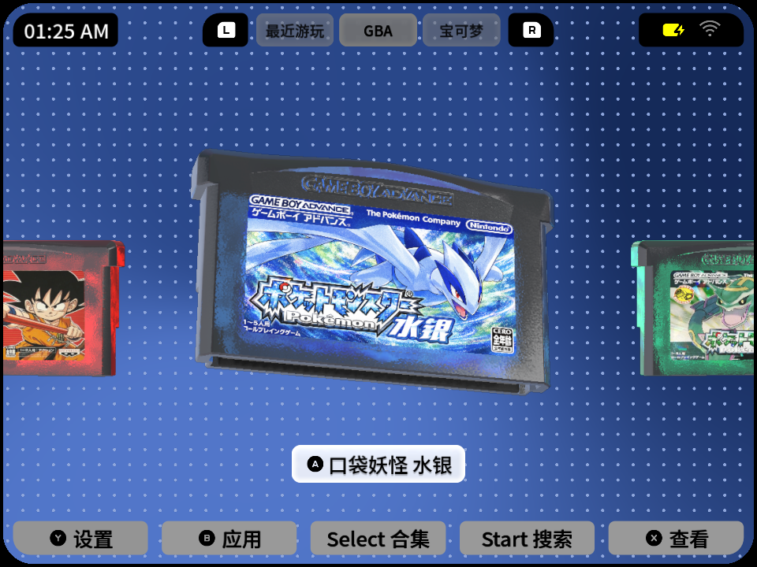
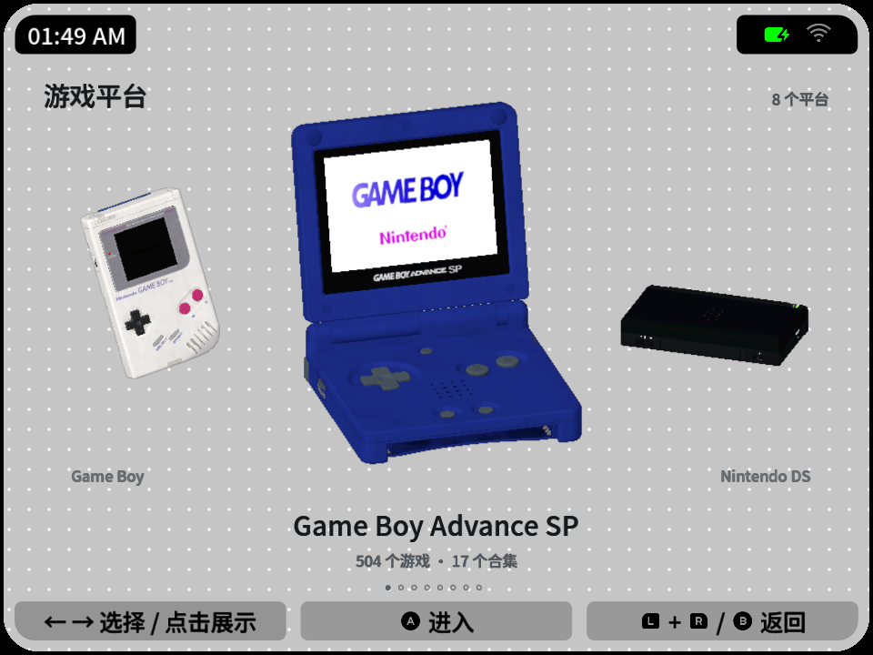
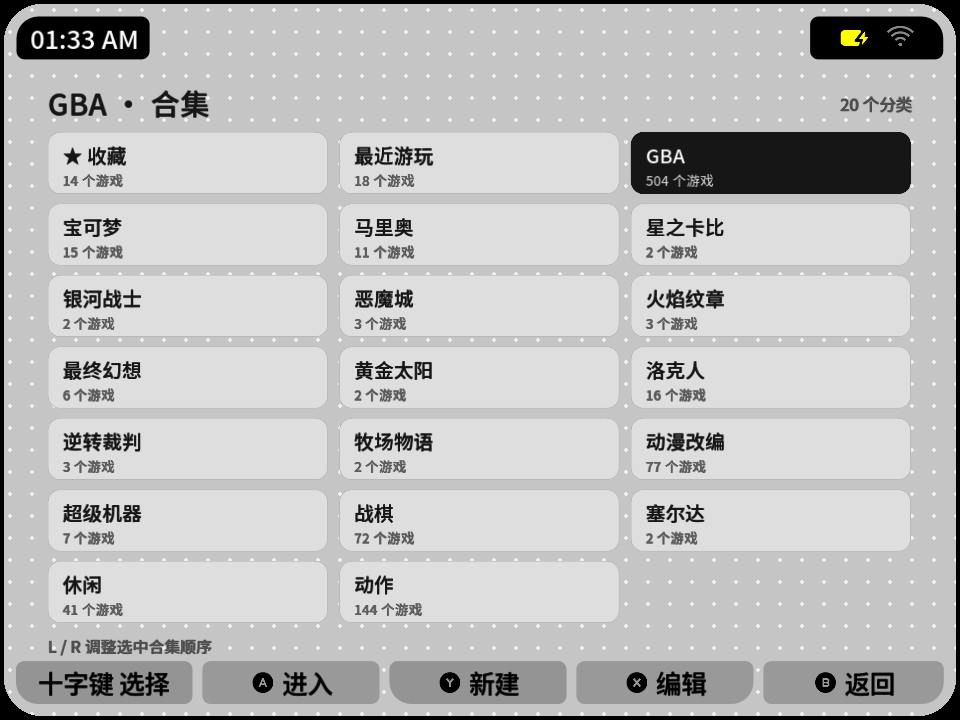
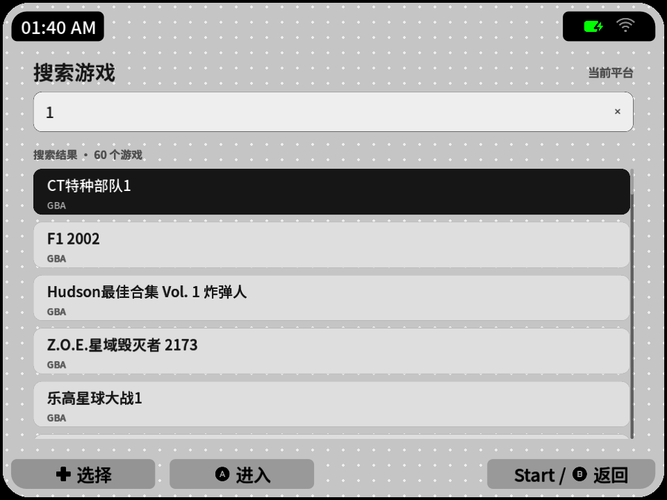
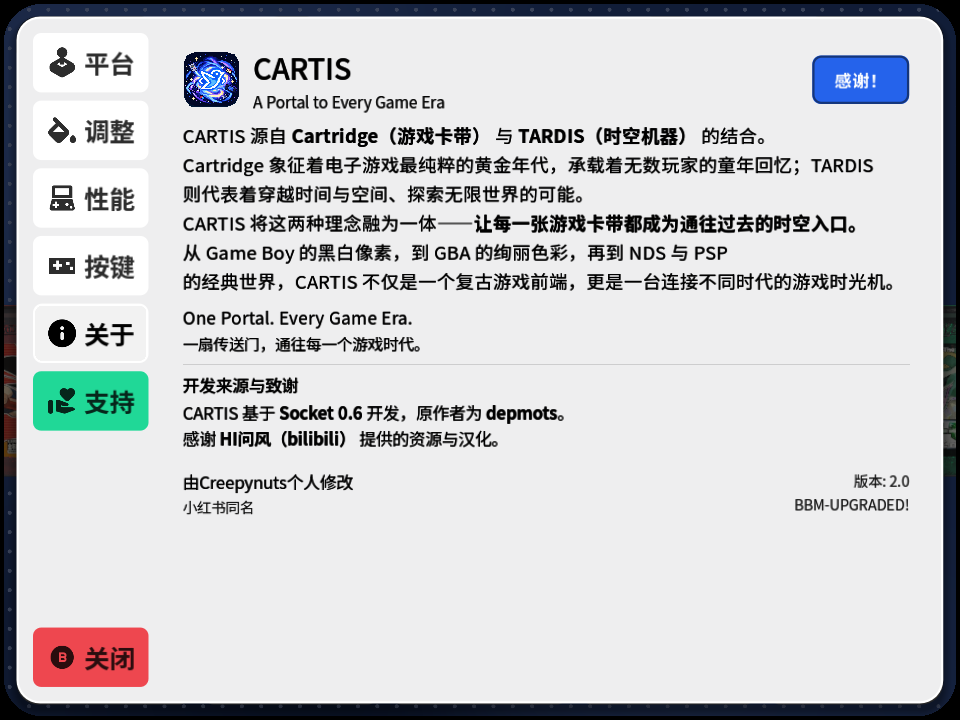
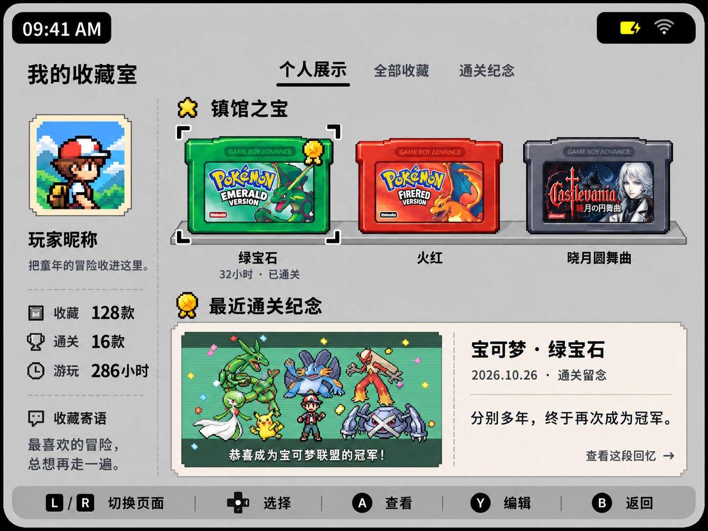

# CARTIS 2.0

**A Portal to Every Game Era**  
一扇传送门，通往每一个游戏时代。

CARTIS 是基于 **Socket 0.6** 修改开发的安卓掌机游戏前端。用立体卡带和主机模型浏览游戏，找回翻选卡带的乐趣，再通过已安装的模拟器进入游戏。

[下载缩放修复版（KPB实测）](https://github.com/FredZ6/CARTIS/releases/download/v2.0-zoom-fix-20261027/CARTIS-2.0-zoom-fix-20261027.apk) · [最新发布说明](https://github.com/FredZ6/CARTIS/releases/tag/v2.0-zoom-fix-20261027) · [新手安装教程](#第一次用按这个顺序来)

[](https://github.com/FredZ6/CARTIS/releases)
[](https://hits.sh/github.com/FredZ6/kpb-socket/)

## 目录

- [软件介绍](#cartis-是什么)
- [2.0 已完成的改动](#相较原版-socket20-已完成哪些改动)
- [性能实测对比](#性能改进以测试记录为准)
- [KPB 实机功能展示](#kpb-实机功能展示)
- [安装与升级须知](#安装与升级前先看)
- [开发来源与致谢](#开发来源与致谢)
- [3.0 开发计划](#接下来30-开发计划)


- [首次使用指南](#第一次用按这个顺序来)
- [第一步：安装 CARTIS](#第一步安装-cartis)
- [第二步：安装模拟器与核心](#第二步先装好模拟器)
- [第三步：整理游戏和封面](#第三步把游戏和封面放好)
- [第四步：添加游戏平台](#第四步告诉-cartis-游戏在哪)
- [日常操作与按键设置](#平时怎么操作)
- [常见问题](#遇到问题先看这里)
- [仓库改名与旧链接](#仓库名称与旧链接)

---

## 最新更新：平台缩放修复

修复3D模型缩放至0.9、0.8后卡带被灰雾覆盖的问题，覆盖所有共用相机的卡带平台。**修复包为versionCode13，基于KPB测试版，已在KPB实机验证；KPA及其他设备尚未验证此整包。** 升级可直接覆盖安装，请先备份配置与存档。

[修复版下载与更新说明](https://github.com/FredZ6/CARTIS/releases/tag/v2.0-zoom-fix-20261027) · [技术记录与实机截图](docs/reports/2026-10-27-camera-zoom-fix.md)

## CARTIS 是什么？

**CARTIS** 源自 **Cartridge（游戏卡带）** 与 **TARDIS（时空机器）** 的结合。Cartridge 承载着电子游戏黄金年代的童年回忆；TARDIS 则寄托着穿越时间与空间、探索无限世界的想象。

CARTIS 将这两种理念融为一体：**让每一张游戏卡带，都成为通往过去的时空入口。** 从 Game Boy 的黑白像素，到 GBA 的绚丽色彩，再到 NDS 与 PSP 的经典世界，连接属于不同年代的游戏回忆。

它负责整理、展示和启动游戏；真正运行游戏的是独立安装的模拟器。**安装包不包含游戏、BIOS、模拟器或 RetroArch 核心。**

## 相较原版 Socket，2.0 已完成哪些改动？

以下功能均已完成。CARTIS 2.0 仍会继续维护和改进，这份列表不是待开发计划。

- **新增游戏平台选择页**：通过立体主机模型切换平台，增加 GBC 等主机模型与平台选项。
- **主机模型互动**：切换到 GBA SP、NDS、3DS 等机型时，支持自动开盖等展示互动。
- **卡带与主机模型放大观赏**：点击模型即可放大，拖动后可从不同角度进行 360° 观赏。
- **熟悉的开机音与背景音**：从特定主机进入卡带页面时，播放对应机型的开机音与背景音；可在设置中独立开关。
- **两档模型质量**：分别调整主机与卡带的“高精细 / 高帧数”模式，适应不同性能的安卓掌机，在细节和流畅度之间选择。
- **更顺滑的页面过渡**：新增页面切换过渡动画，减少页面生硬跳转。
- **平台独立合集与搜索页**：新增合集列表和游戏搜索，支持合集创建、改名、删除与排序；游戏添加合集的菜单按所属平台同步。
- **KPA 已完成适配**：针对 KPA 与 KPB 的屏幕比例调整布局、平台名称与底部菜单显示，并修正 NDS 模型切换时缩小的问题。
- **支持覆盖升级**：沿用原包名与签名，升级时保留游戏目录配置和个人设置；不要卸载或清除数据。
- **持续处理用户反馈**：修复已发现的模型、布局、返回恢复及其他使用问题。
- **全新 CARTIS 外观与设置页**：新像素鸟图标、自适应像素加载页、真实加载进度、统一按键页风格和更完整的关于页。
- **卡带详情页更清爽**：按 X 后暂时隐藏左侧名称标签与无效的 Select 合集按钮，按 B 返回卡带选择页时恢复。
- **性能优化**：批量绘制点阵背景，避免方向键操作时重复遍历游戏库，保留透明卡带、封面清晰度与八模型缓存。实测结果如下。

### 性能改进：以测试记录为准

本轮测试说明见 [KPB 性能对照报告](docs/reports/2026-10-27-kpb-performance.md)。

| 测试场景 / 指标 | 优化前 | 优化后 | 测试范围 |
| --- | --- | --- | --- |
| KPB 主机模型放大、持续旋转 | 45.66–46.28 FPS | 57.40–57.50 FPS | 相同动作交替 A/B 复测，点阵背景批量绘制 |
| KPB GBA 卡带左右切换 | 36.45–36.61 FPS | 39.07–39.30 FPS | 同一真实输入分发动作的 A/B 测试 |
| 上述 GBA 切换 P95 帧间隔 | 约 82.64 ms | 约 49.56 ms | 长帧间隔缩短；不是平均帧时间 |
| KPB 主机模型放大场景绘制调用 | 约 1,562 次 | 约 111 次 | 批量绘制背景后，单帧 draw calls 减少 |
| 较早启动优化的三轮平均冷启动 | 17.40 秒 | 17.03 秒 | 2026-10-25 同口径报告，提升约 2.1% |
| 上述测试中八模型缓存准备时间 | 21.13 秒 | 20.24 秒 | 较早构建，提升约 4.2%，不代表首屏等待时间 |

稳定无诊断包另测得 GBA 静止 **41.19 FPS**、左右切换 **39.34 FPS**；30 秒切换采样中超过 100 ms 的帧为 0。不同页面和操作必须分开比较，不能把主机模型接近 60 FPS 写成所有场景稳定 60 FPS。

**内存、耗电和热启动**：八模型缓存继续保留；本轮没有完整的同口径内存、耗电与热启动对照数据，因此不宣称降低百分比，也不使用“冷启动、热启动减少 50%”的说法。较早的后台缓存报告见 [内存与恢复测试](docs/reports/2026-10-25-background-model-cache.md)，启动数据见 [冷启动测试](docs/reports/2026-10-25-startup-optimization.md)。

## KPB 实机功能展示

以下为 KPB 实机截图。[查看完整功能图集：27 张截图](docs/SHOWCASE.md)，包含加载进度、八种主机、模型放大旋转、合集、新建与编辑、搜索、应用列表和全部设置页面。

| 游戏卡带浏览 | 游戏平台选择 |
| --- | --- |
|  |  |

| 合集管理 | 游戏搜索 |
| --- | --- |
|  |  |

<details>
<summary>预览像素加载页与关于页</summary>




</details>

## 安装与升级前先看

- **已有 Socket BBM / Replay / CARTIS 的用户**：本次安装包沿用原包名与签名，可覆盖安装；不要先卸载或清除数据，升级前建议备份自己的配置与存档。
- **KPB 3GB**：当前主要实测设备。保留现有画质设置的稳定检查点中，GBA 卡带页静止约 **41.19 FPS**，左右切换约 **39.34 FPS**；具体帧率随场景、设备状态与游戏库变化，**不是稳定 60 FPS**。
- **KPA**：已完成适配；本次最终关于页按 960×640 完成布局检查，最终整包尚未重新在 KPA 实机验证。其他屏幕也采用自适应布局，但不承诺所有设备都无须调整。
- **KPB 2GB**：本版未做实机验证。八模型后台缓存会占用较多内存，“高帧数”不等于低内存模式，请先备份并谨慎选择版本。
- **性能选项**：可以分别选择“高精细”与“高帧数”；游戏画面中的帧率和模拟器兼容性由所选模拟器、核心与设备共同决定。

本轮后续性能实验已暂停，正式版保留已确认的优化，没有加入取消折射、改不透明外壳、继续降低清晰度或切换 OpenGL 的实验方案。更多变化与验证范围见 [2.0 更新说明](docs/releases/CARTIS-2.0-20261027.md)。

## 开发来源与致谢

CARTIS 基于 **Socket 0.6** 开发，原作者为 **depmots**。原项目官网：[depmots.com/socket](https://depmots.com/socket)。

由 **Creepynuts** 个人修改，小红书同名。感谢 **HI问风（bilibili）** 提供的资源与汉化。

CARTIS 是独立修改项目，不代表原作者或相关厂商。教程与第三方程序、图片和素材的许可范围见 [LICENSING.md](LICENSING.md)。

如果喜欢，可以在 **设置 → 支持** 中自愿支持开发；海外用户也可以使用 [PayPal](https://paypal.me/seabird26)。

## 接下来：3.0 开发计划

以下是下一阶段的计划，**尚未作为 3.0 功能发布**；上文列出的 2.0 改动均已完成。

- **补充剩余 12 个游戏机模型**，继续完善主机展示与平台选择。
- **个人页面布置**，打造属于自己的个人展示与收藏空间。
- **暗夜模式**，提供适合夜间浏览的深色界面。
- **更多语言**，新增英语与繁体中文。
- **更多字体（评估中）**，探索更多适合掌机阅读与展示的字体选项。
- **地区卡带适配**，区分美版 NES 与日版红白机 Famicom 等不同地区的卡带外形，让模型展示更贴近真实卡带。

### 个人页面概念展示

下图为 3.0 个人页面的设计概念，**不是当前版本实机截图，也不代表最终实现效果**。



## 教程目录

- [第一次用？按这个顺序来](#第一次用按这个顺序来)
- [第一步：安装 CARTIS](#第一步安装-cartis)
- [第二步：先装好模拟器](#第二步先装好模拟器)
- [第三步：把游戏和封面放好](#第三步把游戏和封面放好)
- [第四步：告诉 CARTIS 游戏在哪](#第四步告诉-cartis-游戏在哪)
- [平时怎么操作？](#平时怎么操作)
- [遇到问题先看这里](#遇到问题先看这里)

---

## 第一次用？按这个顺序来

**安装 CARTIS → 安装模拟器 → 放好游戏和封面 → 在 CARTIS 里添加平台。**

CARTIS 是“挑选和打开游戏的桌面”。真正运行游戏的是模拟器，所以只装 CARTIS 还不能直接玩。

## 第一步：安装 CARTIS

1. 打开 [安装包下载页](https://github.com/FredZ6/CARTIS/releases/latest)。
2. 找到 **Assets（资源）**：KPB本次修复包为 **`CARTIS-2.0-zoom-fix-20261027.apk`**；KPA及其他设备请先阅读顶部的验证范围。2GB设备请先阅读内存说明，`Source code` 不是安装包。
3. 在掌机的文件管理器里找到 APK，点开安装。如果安卓询问是否允许安装，按提示允许。
4. 已经装过 CARTIS 的用户，直接覆盖安装即可。**不要先卸载，也不要点“清除数据”**，以免丢失配置。

> **首次启动提示：** 启动时会显示像素风加载画面、进度条和当前阶段。请等待进入游戏库，不要连续重复打开应用。

想用 Home 键从游戏回到 CARTIS：去安卓的 **设置 → 默认应用 → 桌面应用**，选择 **CARTIS**。不同设备的菜单名称可能略有不同。

字体可以在 **设置 → 调整** 中切换，选择自己喜欢的风格。

## 第二步：先装好模拟器

**CARTIS 不会自动帮你安装模拟器或核心。** 可以把它理解成：CARTIS 是“游戏书架”，模拟器是“游戏机”，核心是 RetroArch 里面运行某个平台的组件。

### ① 我要玩什么，就装什么

下面的链接是模拟器的官网或项目官方说明。打开下载页后，请选 **Android / APK**，不要下载 Windows、macOS 版本。

| 想玩的游戏平台 | 可以使用的模拟器 / 核心 | 下载入口与说明 |
| --- | --- | --- |
| **GBA** | RetroArch ＋ **mGBA** 核心 | [RetroArch 官方下载](https://buildbot.libretro.com/stable/1.22.2/android/RetroArch.apk) · [mGBA 核心说明](https://docs.libretro.com/library/mgba/) |
| **GB / GBC** | RetroArch ＋ **Gambatte** 核心 | [RetroArch 官方下载](https://buildbot.libretro.com/stable/1.22.2/android/RetroArch.apk) · [Gambatte 核心说明](https://docs.libretro.com/library/gambatte/) |
| **NDS / DS** | RetroArch ＋ **melonDS DS** 核心 | [RetroArch 官方下载](https://buildbot.libretro.com/stable/1.22.2/android/RetroArch.apk) · [melonDS DS 核心说明](https://docs.libretro.com/library/melonds_ds/) |
| **PSP** | **PPSSPP** 独立应用 | [PPSSPP 官方下载](https://www.ppsspp.org/download/)；选择 Android 下的 **APK for Android** |
| **PS1 / PSX** | RetroArch ＋ **PCSX ReARMed** 核心 | [RetroArch 官方下载](https://buildbot.libretro.com/stable/1.22.2/android/RetroArch.apk) · [PCSX ReARMed 核心说明](https://docs.libretro.com/library/pcsx_rearmed/) |
| **3DS** | **Azahar** 独立应用 | [Azahar 官方网站](https://azahar-emu.org/)；从官网进入下载页面，选择 Android 版本 |
| **PS2** | 可尝试 RetroArch ＋ **Play!** 核心，或 CARTIS 列表中与你已装应用对应的其他 PS2 启动项 | [RetroArch 官方下载](https://buildbot.libretro.com/stable/1.22.2/android/RetroArch.apk) · [Play! 核心说明](https://docs.libretro.com/library/play/)；Play! 核心仍属实验性方案，不作为新手首选 |

**不用把全部模拟器都装一遍。** 例如只玩 GBA，就先安装 RetroArch 和 mGBA；同时玩 GBA、PS1，只需安装一份 RetroArch，再分别下载两个核心。PPSSPP 这类独立模拟器则是另外安装的 APK。

3DS、PS2 对设备性能和游戏兼容性的要求更高。页面有主机模型，不代表你的掌机能流畅运行该平台所有游戏；本项目尚未逐一验证上表所有方案在所有设备上的启动与性能。

### ② 用 GBA 举例：安装 RetroArch 和 mGBA

**A. 先安装 RetroArch 本体**

1. 打开 [RetroArch 官方下载页](https://buildbot.libretro.com/stable/1.22.2/android/RetroArch.apk)，找到 **Android**。
2. 按设备的安卓系统架构选择 APK。系统支持 64 位的掌机可选 **Download (64bit)**；32 位系统选 **Download (32bit)**。不确定时先查设备说明，不要同时装几种版本。
3. 下载后，在掌机文件管理器中点开 APK 安装，再打开一次 RetroArch，按提示允许访问游戏目录。

RetroArch 官方目前提示 Google Play 版本较旧，建议从官网下载。掌机不能直接访问官网时，可以用电脑下载 APK，再复制到掌机安装。

**B. 再安装 mGBA 核心**

联网后，在 RetroArch 里按这个顺序操作：

```text
主菜单 Main Menu
  ↓
加载核心 Load Core
  ↓
下载核心 Download a Core
  ↓
找到 Nintendo - Game Boy Advance (mGBA)
  ↓
点击下载，等待完成
```

有些界面也可以从 **在线更新器（Online Updater）→ 核心下载器（Core Downloader）** 进入。菜单文字会随语言和版本略有不同，可对照 [官方核心安装教程](https://docs.libretro.com/guides/download-cores/)。

**mGBA 在这里是 RetroArch 内的核心，不是需要再装一次的独立安卓应用。** 上表其他 RetroArch 核心也按同样方式下载，只是要选择对应名称。

**C. 先直接在 RetroArch 里试游戏**

1. 回到主菜单，选择 **加载核心 → mGBA**。
2. 选择 **加载内容（Load Content）**，找到你的 `.gba` 游戏文件并打开。
3. 确认游戏能正常运行，再回 CARTIS 添加 GBA 平台。

核心列表加载不出来时，先检查掌机网络和 RetroArch 下载来源；只在 CARTIS 里切换选项，不能代替下载缺失的核心。

### ③ PSP 用户：直接安装 PPSSPP

1. 打开 [PPSSPP 官方下载页](https://www.ppsspp.org/download/)，点 Android 下的 **APK for Android**，安装下载的 APK。
2. 打开 PPSSPP，允许读取 PSP 游戏目录，先在 PPSSPP 里选择一个游戏，确认能玩。
3. 再回 CARTIS 添加 PSP 平台，模拟器选择 **PPSSPP**。

这里使用独立版 PPSSPP，不需要再进 RetroArch 下载 PSP 核心。PPSSPP 也有同名的 RetroArch 核心，那是另一种启动方案，设置时不要把两者混在一起。

### ④ 回到 CARTIS，选对模拟器和核心

按 **Y → 平台 → 添加平台**（已有平台则进入编辑），选择游戏目录和实际安装的模拟器。

| 你实际准备好的环境 | CARTIS 中该选什么 |
| --- | --- |
| RetroArch 64 位，已下载 mGBA | 对应的 **RetroArch 64 / mGBA** 启动项 |
| RetroArch 32 位，已下载 mGBA | 对应的 **RetroArch 32 / mGBA** 启动项 |
| 其他包名的 RetroArch，已下载 mGBA | 与实际安装版本匹配的 **RetroArch / mGBA** 启动项 |
| 独立版 PPSSPP | **PPSSPP** 启动项，不选 RetroArch 的 PPSSPP 核心 |
| Azahar | 与所安装版本对应的 **Azahar** 启动项；不要仅凭名字相似选择旧 Citra / Lime3DS 启动项 |

选项具体名称以当前 CARTIS 列表为准。**应用版本、核心和启动项要相互对应**：例如没有安装 64 位 RetroArch，却选了 RetroArch 64，可能无法打开游戏；下载了 mGBA，却选另一个尚未安装的 GBA 核心，也会启动失败。

### ⑤ BIOS 和系统文件放哪里？

BIOS 可以理解为某些游戏机启动所需的系统文件。**不是所有平台、所有核心都必须另外准备 BIOS**；例如 mGBA 的 GBA BIOS 是可选项。

需要 BIOS 或固件时，按上表对应核心的官方说明准备，使用你有权使用的文件。RetroArch 中可在 **设置 → 目录 → 系统 / BIOS（System/BIOS）** 查看实际放置路径；不要照抄别人的存储目录。独立模拟器则按自己的设置页面操作。

**最重要的一步：先在模拟器里打开游戏，确认能玩，再从 CARTIS 启动。** CARTIS 安装包不包含游戏、BIOS、模拟器和输入法，也不会自动替你安装这些组件。

## 第三步：把游戏和封面放好

游戏资源和封面可以通过这个链接下载：[夸克网盘下载](https://pan.quark.cn/s/8deecaf6406f)。请使用你有权使用的资源。

额外的游戏资源：[【腾讯文档】天马G 定制配置包 汇总文档](https://docs.qq.com/sheet/DZVBNVmxNZ29GZ2Fn)。

先以一个 GBA 游戏为例操作成功，再整理其他平台。

### ① 建一个放游戏的文件夹

在掌机的**内部存储**里，新建 `天马游戏包`，再在里面新建 `GBA`。把 GBA 游戏文件放进去。

内部存储也可能在文件管理器里显示为“本机存储”。`天马游戏包` 只是建议名称，不必和示例完全相同；放在 SD 卡也可以。

### ② 在游戏文件夹里，再建一个封面文件夹

在 `GBA` 里面新建 **`lmgs`**，把封面图片放进去。注意开头是**小写字母 l**。


### ③ 把游戏和封面改成对应的名字

例如游戏叫 `口袋妖怪 水银.gba`，对应封面就叫 `口袋妖怪 水银.png`。


推荐使用 PNG 或 JPG 图片；也支持 JPEG、WebP 和 BMP。只改扩展名不会转换图片格式。

其他平台照着建即可：

```text
天马游戏包/
├── GBA/      ← GBA 游戏，里面另建 lmgs 放封面
├── NDS/      ← NDS 游戏，里面另建 lmgs 放封面
├── PSP/      ← PSP 游戏，里面另建 lmgs 放封面
└── PS1/      ← PS1 游戏，里面另建 lmgs 放封面
```

下载的是外层压缩包时，先解压再整理。游戏支持什么格式，要以所选模拟器和平台扫描规则为准；光盘游戏的配套文件请一起保留。

## 第四步：告诉 CARTIS 游戏在哪

1. 在 CARTIS 主界面按 **Y**，或触屏点左下角 **设置**。
2. 点 **平台 → 添加平台**，选择 **GBA**。
3. 选择已安装的模拟器，并配置对应核心或启动方式。
4. 选择刚才的 **`天马游戏包/GBA`** 文件夹，允许 CARTIS 读取。
5. 保存，等扫描完成后回到主界面。

**这里选择 GBA 文件夹，不要选 lmgs。** `lmgs` 只装图片，不装游戏。


PSP、NDS 等平台分别添加一次。建好文件夹并不等于已经添加平台，也不等于已经安装模拟器。

## 平时怎么操作？

下面是默认按键。改绑以后，请看屏幕上的提示。

| 在主界面按 | 会发生什么 |
| --- | --- |
| 十字键左右 | 换一个游戏 |
| A | 打开选中的游戏 |
| B | 打开应用列表 |
| Y | 打开设置 |
| X | 查看游戏 |
| Select | 打开当前游戏平台的合集列表 |
| Start | 打开搜索，输入游戏名找游戏 |
| 单按 L 或 R | 切换上一个 / 下一个合集 |
| 同时按 L＋R | 打开游戏平台选择页 |

进入合集或平台页后，**方向键选择，A 进入，B 返回**。

合集按平台分别管理。在合集列表按 **Y 新建、X 编辑、L / R 调整选中合集的顺序**；游戏页会同步这个顺序。选中游戏后，通过 X 菜单添加到合集，只会显示当前游戏平台的合集。

搜索时可以触屏打字；十字键上下选结果，A 启动。**B 先收键盘，再按一次 B 返回主界面。**

点击中间的卡带或游戏机模型，可以放大；在屏幕拖动可以转着看，再点模型或按 B 退出。

### 想调整画面和互动？打开“性能”

打开 **设置 → 性能**，可以分别调整“游戏机模型质量”和“游戏模型质量”：

- **高精细**：保留完整材质效果。
- **高帧数**：简化部分复杂材质计算，保留封面和透明卡带质感；实际帧率会随设备、平台和场景变化。

同一页还可以独立开关 **游戏机模型互动、进入卡带页面音效、卡带页面背景音**。修改后自动保存，重启后仍然生效。

首次安装默认使用 **高帧数** 模式，以上三个互动开关默认开启；覆盖安装会保留你原来保存的设置。

### 按键不顺手？可以自己改

打开 **设置 → 按键**：

1. 选一个功能，比如“所有合集”。
2. 按你想用的实体键，也可以同时按组合键，例如 L＋R。
3. 全部松开，再点 **保存绑定**。

保存后立即生效，下次打开仍然保留，底部提示也会更新。最多支持 3 个按键组合。

- 提示“按键已被使用”：可以取消重选；如果选择替换，另一个冲突功能会变成未绑定。
- 想改回原来：点 **恢复默认按键**。
- 录入时想取消：触屏点 **取消录入**，或按安卓返回键。此时 B 也能被录入，不能当作固定取消键。
- 方向键保留用来导航；Home 由安卓系统处理，需要把 CARTIS 设为默认桌面。

这里只改 CARTIS 的操作。模拟器里的快进、即时存档等快捷键，需要到模拟器里设置。

## 遇到问题先看这里

| 遇到的情况 | 先检查什么 |
| --- | --- |
| 看不到游戏 | 平台选的是否是游戏目录？文件是否已解压？是否允许读取？格式是否支持？ |
| 有游戏但没封面 | 图片是否放在该平台的 `lmgs` 里？名字是否与原游戏文件一致？图片能否正常打开？ |
| 加了新游戏却没出现 | 回平台设置重新扫描；不要只复制文件后就删除原配置。 |
| 换了封面还是旧图 | 先重新打开 CARTIS；必要时在游戏自定义界面手动选择封面。 |
| 游戏打不开 | 先直接在模拟器里试。模拟器能运行后，再检查 CARTIS 里的模拟器、核心和启动设置。 |
| 键盘弹出但打不了字 | 先用键盘的语言切换键切到英文，再切回中文。仍不行可更换中文输入法；输入法需要另外安装。 |
| Home 没回 CARTIS | 检查安卓的默认桌面是否选了 CARTIS。 |

文件夹名字、封面命名和权限不正确时，不需要靠卸载 CARTIS 或清空全部数据解决。


## 仓库名称与旧链接

本仓库已由 `FredZ6/kpb-socket` 改名为 **`FredZ6/CARTIS`**。GitHub 自动将旧仓库页面、文件和发布入口跳转到新地址；已有 Star、Issue 和提交历史均保留。请收藏新地址：[github.com/FredZ6/CARTIS](https://github.com/FredZ6/CARTIS)。

README 访问统计沿用旧计数键，避免改名后重新计数。下载统计包含所有历史 Releases 附件，受缓存影响，不等同安装人数。
