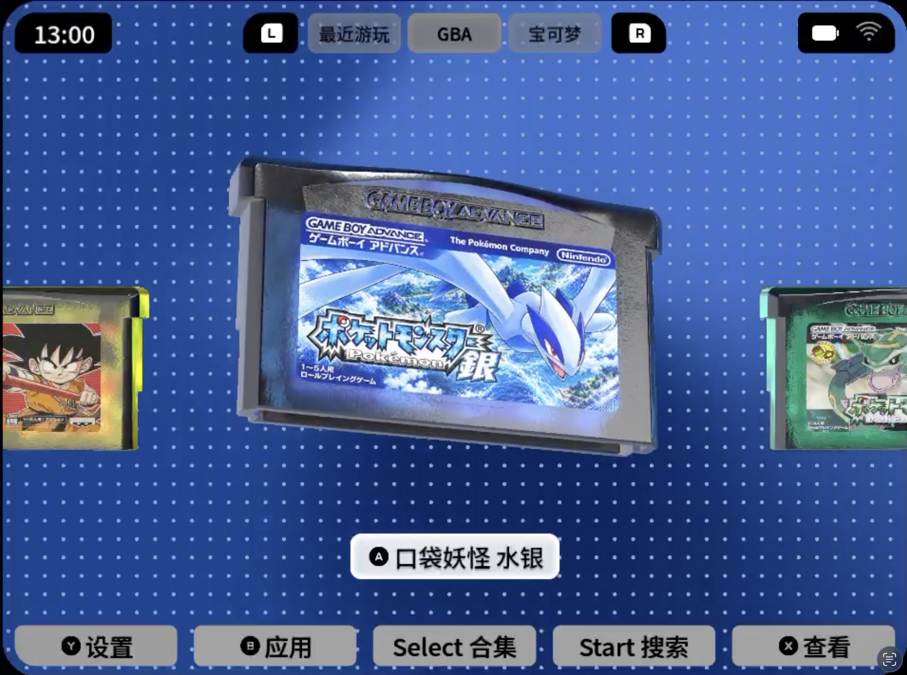
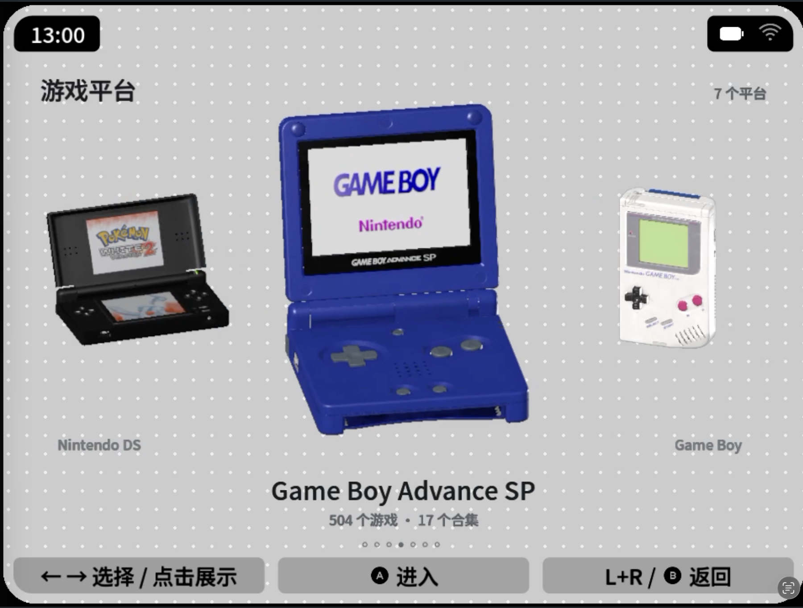
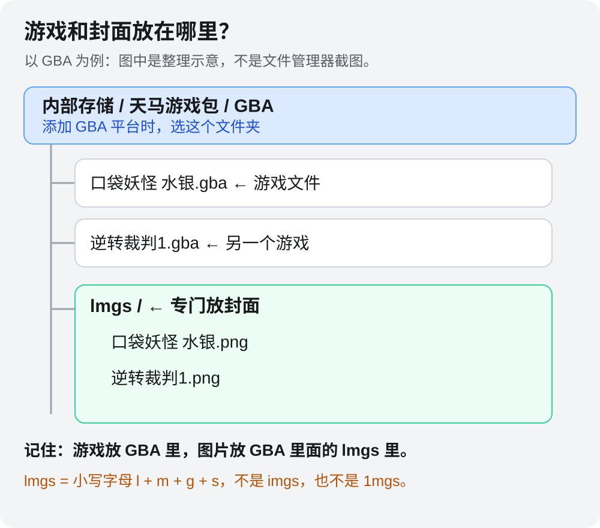
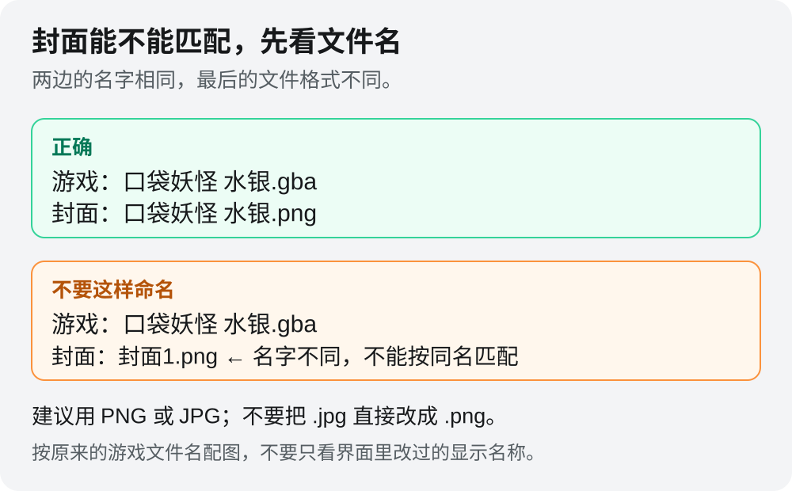
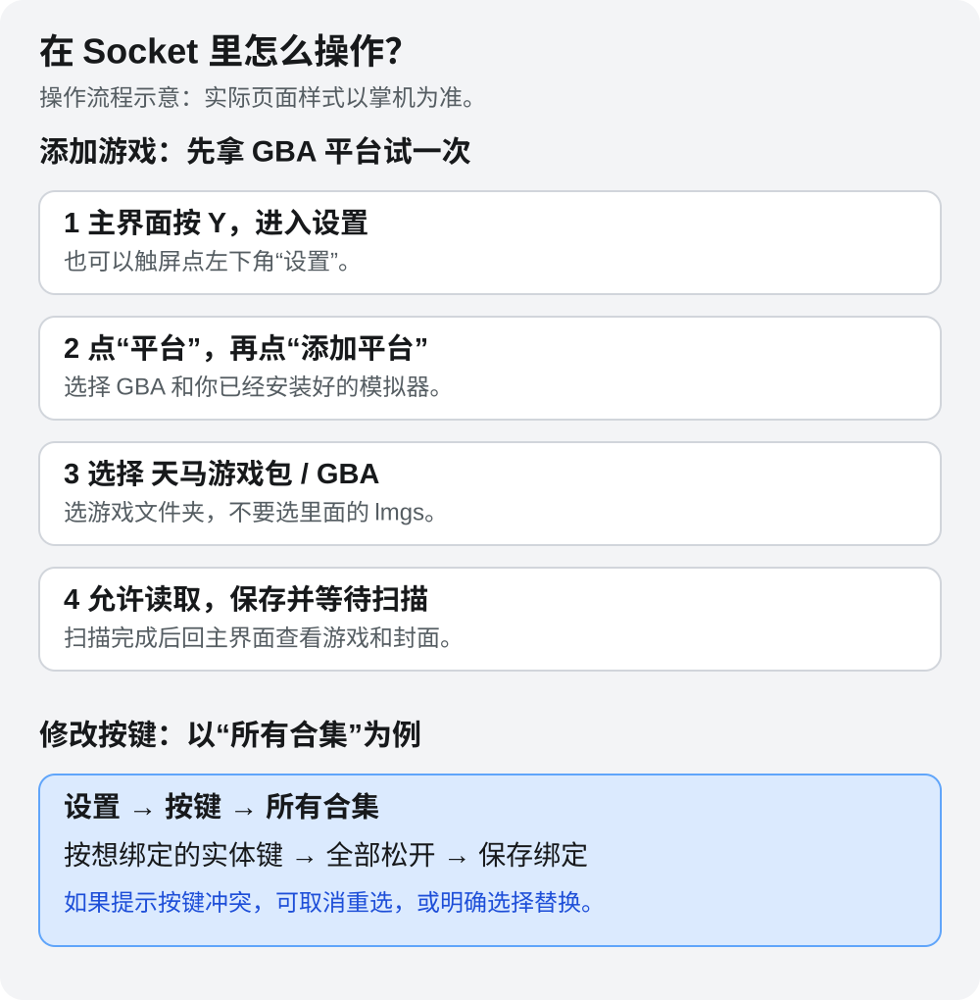

# Socket BBM

## 目录

- [最新版：2026-10-25 后台模型缓存版](#最新版2026-10-25-后台模型缓存版)
- [第一次用？按这个顺序来](#第一次用按这个顺序来)
- [第一步：安装 Socket](#第一步安装-socket)
- [第二步：先装好模拟器](#第二步先装好模拟器)
- [第三步：把游戏和封面放好](#第三步把游戏和封面放好)
- [第四步：告诉 Socket 游戏在哪](#第四步告诉-socket-游戏在哪)
- [平时怎么操作？](#平时怎么操作)
- [遇到问题先看这里](#遇到问题先看这里)
- [访问与下载统计](#访问与下载统计)

> [!IMPORTANT]
> **2GB 内存版 KPB：请先阅读本版内存说明**
>
> 安装最新版后，打开 **设置 → 性能**，将 **游戏机模型质量** 和 **游戏模型质量** 都选择为 **高帧数**。该模式会简化部分复杂材质计算，保留游戏封面和透明卡带质感，帮助改善浏览游戏和切换模型时的流畅度。
>
> 当前主要在 **3GB 内存版 KPB** 上开发和测试，2GB 设备的实际体验会因设备和游戏库大小而不同，不保证固定帧率。
>
> **2026-10-25 后台模型缓存版**会在游戏中和熄屏后保留八台模型。3GB 设备实测 Socket 整体后台 PSS 约 **1.12 GiB**；本版尚未在 2GB 设备验证。“高帧数”简化材质计算，不等于低内存占用。安装前请备份配置，历史构建见 [全部版本](https://github.com/FredZ6/kpb-socket/releases)。
>
> 如果开启高帧数后仍明显卡顿，或出现内存不足、黑屏等问题，，也可以考虑 Beacon 或天马 G 前端。
>
> 备用版是较早的构建，功能以该版本为准；切换版本前请先备份自己的配置。


目前的版本尚未完全开发完毕，后续开发完成后会继续更新。如果喜欢的话，请多多支持！（安装好 Socket 后，可以在设置里找到神秘支持按钮哦。）

海外用户也可以通过 PayPal 支持开发：[💙 PayPal 打赏](https://paypal.me/seabird26)。





适配 KPB、KPA 等安卓掌机的游戏前端，使用 3D 卡带和主机模型浏览游戏。游戏通过单独安装的模拟器运行。

## 最新版：2026-10-25 后台模型缓存版

进入游戏或熄屏后保留八台游戏机模型，后台停止模型绘制；再次进入游戏平台时直接使用缓存，移除“正在打开”弹窗。保留当前模型、贴图、透明质感，以及封面匹配分帧修复。

[下载最新 APK](https://github.com/FredZ6/kpb-socket/releases/download/v2026.10.25-background-model-cache/socket-bbm-background-model-cache-20261025.apk) · [完整发布页](https://github.com/FredZ6/kpb-socket/releases/tag/v2026.10.25-background-model-cache) · [实测报告](docs/reports/2026-10-25-background-model-cache.md) · [性能数据 ZIP](https://github.com/FredZ6/kpb-socket/releases/download/v2026.10.25-background-model-cache/performance-data-20261025.zip)

3GB KPB 两组约20秒实测：亮屏回卡带页 **29.89 FPS**，实际游戏按 Home 返回 **30.22 FPS**，均无超过100ms的长帧。未达到稳定60FPS；2GB设备、重负载模拟器长时并行和熄屏耗电尚未验证，测量条件与限制见报告。

## 第一次用？按这个顺序来

**安装 Socket → 安装模拟器 → 放好游戏和封面 → 在 Socket 里添加平台。**

Socket 是“挑选和打开游戏的桌面”。真正运行游戏的是模拟器，所以只装 Socket 还不能直接玩。

## 第一步：安装 Socket

1. 打开 [安装包下载页](https://github.com/FredZ6/kpb-socket/releases/latest)。
2. 找到 **Assets（资源）**：通常下载 **`socket-bbm-background-model-cache-20261025.apk`（最新版）**；2GB 设备请先阅读顶部的内存说明，`Source code` 不是安装包。
3. 在掌机的文件管理器里找到 APK，点开安装。如果安卓询问是否允许安装，按提示允许。
4. 已经装过 socket-bbm 的用户，直接覆盖安装即可。**不要先卸载，也不要点“清除数据”**，以免丢失配置。

> **首次启动提示：** 安装完成后第一次打开 Socket，可能会先黑屏加载几秒，这是正常的初始化过程，请耐心等待进入主界面，不要连续重复打开应用。

想用 Home 键从游戏回到 Socket：去安卓的 **设置 → 默认应用 → 桌面应用**，选择 **socket-bbm**。不同设备的菜单名称可能略有不同。

## 第二步：先装好模拟器

**Socket 不会自动帮你安装模拟器或核心。** 可以把它理解成：Socket 是“游戏书架”，模拟器是“游戏机”，核心是 RetroArch 里面运行某个平台的组件。

### ① 我要玩什么，就装什么

下面的链接是模拟器的官网或项目官方说明。打开下载页后，请选 **Android / APK**，不要下载 Windows、macOS 版本。

| 想玩的游戏平台 | 可以使用的模拟器 / 核心 | 下载入口与说明 |
| --- | --- | --- |
| **GBA** | RetroArch ＋ **mGBA** 核心 | [RetroArch 官方下载](https://buildbot.libretro.com/stable/1.22.2/android/RetroArch.apk) · [mGBA 核心说明](https://docs.libretro.com/library/mgba/) |
| **GB / GBC** | RetroArch ＋ **Gambatte** 核心 | [RetroArch 官方下载](https://buildbot.libretro.com/stable/1.22.2/android/RetroArch.apk) · [Gambatte 核心说明](https://docs.libretro.com/library/gambatte/) |
| **NDS / DS** | RetroArch ＋ **melonDS DS** 核心 | [RetroArch 官方下载](https://buildbot.libretro.com/stable/1.22.2/android/RetroArch.apk) · [melonDS DS 核心说明](https://docs.libretro.com/library/melonds_ds/) |
| **PSP** | **PPSSPP** 独立应用 | [PPSSPP 官方下载](https://www.ppsspp.org/download/)；选择 Android 下的 **APK for Android** |
| **PS1 / PSX** | RetroArch ＋ **PCSX ReARMed** 核心 | [RetroArch 官方下载](https://buildbot.libretro.com/stable/1.22.2/android/RetroArch.apk) · [PCSX ReARMed 核心说明](https://docs.libretro.com/library/pcsx_rearmed/) |
| **3DS** | **Azahar** 独立应用 | [Azahar 官方网站](https://azahar-emu.org/)；从官网进入下载页面，选择 Android 版本 |
| **PS2** | 可尝试 RetroArch ＋ **Play!** 核心，或 Socket 列表中与你已装应用对应的其他 PS2 启动项 | [RetroArch 官方下载](https://buildbot.libretro.com/stable/1.22.2/android/RetroArch.apk) · [Play! 核心说明](https://docs.libretro.com/library/play/)；Play! 核心仍属实验性方案，不作为新手首选 |

**不用把全部模拟器都装一遍。** 例如只玩 GBA，就先安装 RetroArch 和 mGBA；同时玩 GBA、PS1，只需安装一份 RetroArch，再分别下载两个核心。PPSSPP 这类独立模拟器则是另外安装的 APK。

3DS、PS2 对设备性能和游戏兼容性的要求更高。页面有主机模型，不代表你的掌机能流畅运行该平台所有游戏；本项目尚未逐一验证上表所有方案在所有设备上的启动与性能。

### ② 用 GBA 举例：安装 RetroArch 和 mGBA

**A. 先安装 RetroArch 本体**

1. 打开 [RetroArch 官方下载页](https://buildbot.libretro.com/stable/1.22.2/android/RetroArch.apk)，找到 **Android**。
2. 按设备的安卓系统架构选择 APK。系统支持 64 位的掌机可选 **Download (64bit)**；32 位系统选 **Download (32bit)**。不确定时先查设备说明，不要同时装几种版本。
3. 下载后，在掌机文件管理器中点开 APK 安装，再打开一次 RetroArch，按提示允许访问游戏目录。

RetroArch 官方目前提示 Google Play 版本较旧，建议从官网下载。掌机不能直接访问官网时，可以用电脑下载 APK，再复制到掌机安装。

**B. 再安装 mGBA 核心**

联网后，在 RetroArch 里按这个顺序操作：

```text
主菜单 Main Menu
  ↓
加载核心 Load Core
  ↓
下载核心 Download a Core
  ↓
找到 Nintendo - Game Boy Advance (mGBA)
  ↓
点击下载，等待完成
```

有些界面也可以从 **在线更新器（Online Updater）→ 核心下载器（Core Downloader）** 进入。菜单文字会随语言和版本略有不同，可对照 [官方核心安装教程](https://docs.libretro.com/guides/download-cores/)。

**mGBA 在这里是 RetroArch 内的核心，不是需要再装一次的独立安卓应用。** 上表其他 RetroArch 核心也按同样方式下载，只是要选择对应名称。

**C. 先直接在 RetroArch 里试游戏**

1. 回到主菜单，选择 **加载核心 → mGBA**。
2. 选择 **加载内容（Load Content）**，找到你的 `.gba` 游戏文件并打开。
3. 确认游戏能正常运行，再回 Socket 添加 GBA 平台。

核心列表加载不出来时，先检查掌机网络和 RetroArch 下载来源；只在 Socket 里切换选项，不能代替下载缺失的核心。

### ③ PSP 用户：直接安装 PPSSPP

1. 打开 [PPSSPP 官方下载页](https://www.ppsspp.org/download/)，点 Android 下的 **APK for Android**，安装下载的 APK。
2. 打开 PPSSPP，允许读取 PSP 游戏目录，先在 PPSSPP 里选择一个游戏，确认能玩。
3. 再回 Socket 添加 PSP 平台，模拟器选择 **PPSSPP**。

这里使用独立版 PPSSPP，不需要再进 RetroArch 下载 PSP 核心。PPSSPP 也有同名的 RetroArch 核心，那是另一种启动方案，设置时不要把两者混在一起。

### ④ 回到 Socket，选对模拟器和核心

按 **Y → 平台 → 添加平台**（已有平台则进入编辑），选择游戏目录和实际安装的模拟器。

| 你实际准备好的环境 | Socket 中该选什么 |
| --- | --- |
| RetroArch 64 位，已下载 mGBA | 对应的 **RetroArch 64 / mGBA** 启动项 |
| RetroArch 32 位，已下载 mGBA | 对应的 **RetroArch 32 / mGBA** 启动项 |
| 其他包名的 RetroArch，已下载 mGBA | 与实际安装版本匹配的 **RetroArch / mGBA** 启动项 |
| 独立版 PPSSPP | **PPSSPP** 启动项，不选 RetroArch 的 PPSSPP 核心 |
| Azahar | 与所安装版本对应的 **Azahar** 启动项；不要仅凭名字相似选择旧 Citra / Lime3DS 启动项 |

选项具体名称以当前 Socket 列表为准。**应用版本、核心和启动项要相互对应**：例如没有安装 64 位 RetroArch，却选了 RetroArch 64，可能无法打开游戏；下载了 mGBA，却选另一个尚未安装的 GBA 核心，也会启动失败。

### ⑤ BIOS 和系统文件放哪里？

BIOS 可以理解为某些游戏机启动所需的系统文件。**不是所有平台、所有核心都必须另外准备 BIOS**；例如 mGBA 的 GBA BIOS 是可选项。

需要 BIOS 或固件时，按上表对应核心的官方说明准备，使用你有权使用的文件。RetroArch 中可在 **设置 → 目录 → 系统 / BIOS（System/BIOS）** 查看实际放置路径；不要照抄别人的存储目录。独立模拟器则按自己的设置页面操作。

**最重要的一步：先在模拟器里打开游戏，确认能玩，再从 Socket 启动。** Socket 安装包不包含游戏、BIOS、模拟器和输入法，也不会自动替你安装这些组件。

## 第三步：把游戏和封面放好

游戏资源和封面可以通过这个链接下载：[夸克网盘下载](https://pan.quark.cn/s/8deecaf6406f)。请使用你有权使用的资源。

额外的游戏资源：[【腾讯文档】天马G 定制配置包 汇总文档](https://docs.qq.com/sheet/DZVBNVmxNZ29GZ2Fn)。

先以一个 GBA 游戏为例操作成功，再整理其他平台。

### ① 建一个放游戏的文件夹

在掌机的**内部存储**里，新建 `天马游戏包`，再在里面新建 `GBA`。把 GBA 游戏文件放进去。

内部存储也可能在文件管理器里显示为“本机存储”。`天马游戏包` 只是建议名称，不必和示例完全相同；放在 SD 卡也可以。

### ② 在游戏文件夹里，再建一个封面文件夹

在 `GBA` 里面新建 **`lmgs`**，把封面图片放进去。注意开头是**小写字母 l**。



### ③ 把游戏和封面改成对应的名字

例如游戏叫 `口袋妖怪 水银.gba`，对应封面就叫 `口袋妖怪 水银.png`。



推荐使用 PNG 或 JPG 图片；也支持 JPEG、WebP 和 BMP。只改扩展名不会转换图片格式。

其他平台照着建即可：

```text
天马游戏包/
├── GBA/      ← GBA 游戏，里面另建 lmgs 放封面
├── NDS/      ← NDS 游戏，里面另建 lmgs 放封面
├── PSP/      ← PSP 游戏，里面另建 lmgs 放封面
└── PS1/      ← PS1 游戏，里面另建 lmgs 放封面
```

下载的是外层压缩包时，先解压再整理。游戏支持什么格式，要以所选模拟器和平台扫描规则为准；光盘游戏的配套文件请一起保留。

## 第四步：告诉 Socket 游戏在哪

1. 在 Socket 主界面按 **Y**，或触屏点左下角 **设置**。
2. 点 **平台 → 添加平台**，选择 **GBA**。
3. 选择已安装的模拟器，并配置对应核心或启动方式。
4. 选择刚才的 **`天马游戏包/GBA`** 文件夹，允许 Socket 读取。
5. 保存，等扫描完成后回到主界面。

**这里选择 GBA 文件夹，不要选 lmgs。** `lmgs` 只装图片，不装游戏。



PSP、NDS 等平台分别添加一次。建好文件夹并不等于已经添加平台，也不等于已经安装模拟器。

## 平时怎么操作？

下面是默认按键。改绑以后，请看屏幕上的提示。

| 在主界面按 | 会发生什么 |
| --- | --- |
| 十字键左右 | 换一个游戏 |
| A | 打开选中的游戏 |
| B | 打开应用列表 |
| Y | 打开设置 |
| X | 查看游戏 |
| Select | 打开所有合集 |
| Start | 打开搜索，输入游戏名找游戏 |
| 单按 L 或 R | 切换上一个 / 下一个合集 |
| 同时按 L＋R | 打开游戏平台选择页 |

进入合集或平台页后，**方向键选择，A 进入，B 返回**。

搜索时可以触屏打字；十字键上下选结果，A 启动。**B 先收键盘，再按一次 B 返回主界面。**

点击中间的卡带或游戏机模型，可以放大；在屏幕拖动可以转着看，再点模型或按 B 退出。

### 想调整画面和互动？打开“性能”

打开 **设置 → 性能**，可以分别调整“游戏机模型质量”和“游戏模型质量”：

- **高精细**：保留完整材质效果。
- **高帧数**：简化部分复杂材质计算，保留封面和透明卡带质感；实际帧率会随设备、平台和场景变化。

同一页还可以独立开关 **游戏机模型互动、进入卡带页面音效、卡带页面背景音**。修改后自动保存，重启后仍然生效。

首次安装默认使用 **高帧数** 模式，以上三个互动开关默认开启；覆盖安装会保留你原来保存的设置。

### 按键不顺手？可以自己改

打开 **设置 → 按键**：

1. 选一个功能，比如“所有合集”。
2. 按你想用的实体键，也可以同时按组合键，例如 L＋R。
3. 全部松开，再点 **保存绑定**。

保存后立即生效，下次打开仍然保留，底部提示也会更新。最多支持 3 个按键组合。

- 提示“按键已被使用”：可以取消重选；如果选择替换，另一个冲突功能会变成未绑定。
- 想改回原来：点 **恢复默认按键**。
- 录入时想取消：触屏点 **取消录入**，或按安卓返回键。此时 B 也能被录入，不能当作固定取消键。
- 方向键保留用来导航；Home 由安卓系统处理，需要把 Socket 设为默认桌面。

这里只改 Socket 的操作。模拟器里的快进、即时存档等快捷键，需要到模拟器里设置。

## 遇到问题先看这里

| 遇到的情况 | 先检查什么 |
| --- | --- |
| 看不到游戏 | 平台选的是否是游戏目录？文件是否已解压？是否允许读取？格式是否支持？ |
| 有游戏但没封面 | 图片是否放在该平台的 `lmgs` 里？名字是否与原游戏文件一致？图片能否正常打开？ |
| 加了新游戏却没出现 | 回平台设置重新扫描；不要只复制文件后就删除原配置。 |
| 换了封面还是旧图 | 先重新打开 Socket；必要时在游戏自定义界面手动选择封面。 |
| 游戏打不开 | 先直接在模拟器里试。模拟器能运行后，再检查 Socket 里的模拟器、核心和启动设置。 |
| 键盘弹出但打不了字 | 先用键盘的语言切换键切到英文，再切回中文。仍不行可更换中文输入法；输入法需要另外安装。 |
| Home 没回 Socket | 检查安卓的默认桌面是否选了 socket-bbm。 |

文件夹名字、封面命名和权限不正确时，不需要靠卸载 Socket 或清空全部数据解决。

## 访问与下载统计

[](https://hits.sh/github.com/FredZ6/kpb-socket/)
[](https://github.com/FredZ6/kpb-socket/releases)

- **README 访问次数**：由 Hits.sh 计数，从 2026-10-25 添加后开始累计，无法补回此前访问记录。受 GitHub 图片缓存、重复访问等影响，仅供参考，不代表独立访客人数，也无法判断是否滚动到本节。
- **发布附件累计下载量**：由 Shields.io 读取 GitHub Releases 数据，包含所有版本的 APK、ZIP 等发布附件下载次数（含历史下载），不是安装人数；不含网盘下载和源码下载。
- 数据会自动更新，可能存在缓存延迟。
