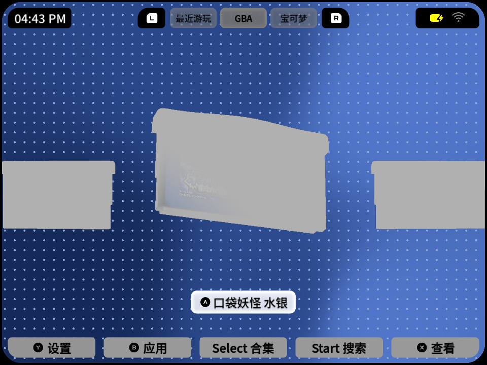
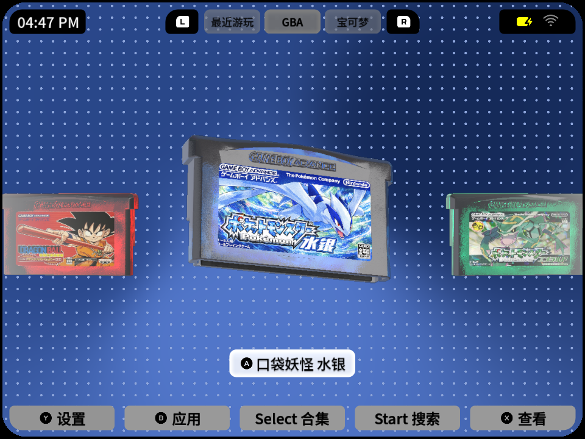

# 卡带缩放后灰化修复 · 2026-10-27

## 根因与修改

共用Camera3D脚本以`position.z = -15.841 / clampf(zoom, 0.5, 2.0)`缩放。主场景采用深度雾，原起止距离16.8～19.4。zoom=0.9时相机距原点17.601，zoom=0.8时19.801，卡带被浓雾覆盖，模型本身仍在场景中。

修复为相机创建独立Environment副本，缩小到1.0以下时将fog_depth_begin/end同步后移，保留原雾范围宽度；1.0以上沿用原效果。原共享WorldEnvironment不被修改，反复缩放不会累加偏移。

[Godot官方深度雾说明](https://docs.godotengine.org/en/4.6/classes/class_environment.html#class-environment-property-fog-depth-begin)。

## 实机与回归

KPB3GB实测：GBA0.8/0.9封面恢复；NDS、PSP、PSX、GBC、GB在0.8下模型正常。3DS/PS2没有真实游戏，使用临时条目只检查模型渲染，空白贴图为无封面时的默认显示，不是游戏启动测试。测试结束恢复原游戏库、各平台缩放值与平台选择。

| 原版 GBA 0.8 | 修复后 GBA 0.8 |
|---|---|
|  |  |

Godot回归测试先证实原脚本在0.9失败，修复后0.5、0.8、0.9、1.0、1.05、2.0、越界钳制、多次切换与多相机隔离通过。源码及测试位于[patches/2026-10-27-camera-zoom](../../patches/2026-10-27-camera-zoom)。

## 包验证与边界

versionCode13基于KPB code12。APK仅相机字节码、对应稀疏资源索引、版本号不同，其余条目逐字节一致；签名保持一致，设备安装APK哈希匹配产物。保留原KPB帧调度配置，未改变画质、模型与纹理；未将此包宣称为KPA等所有设备验证版本，未追加完整FPS复测。
